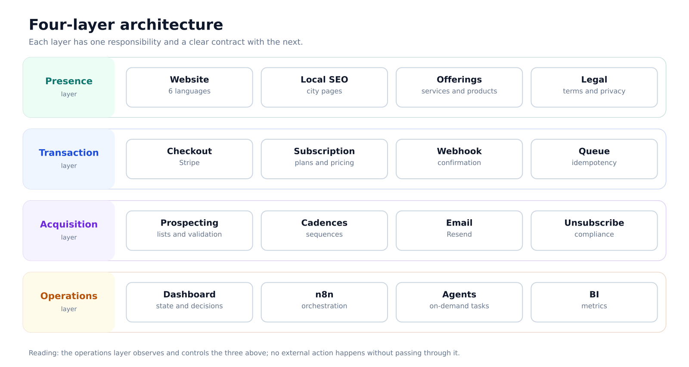
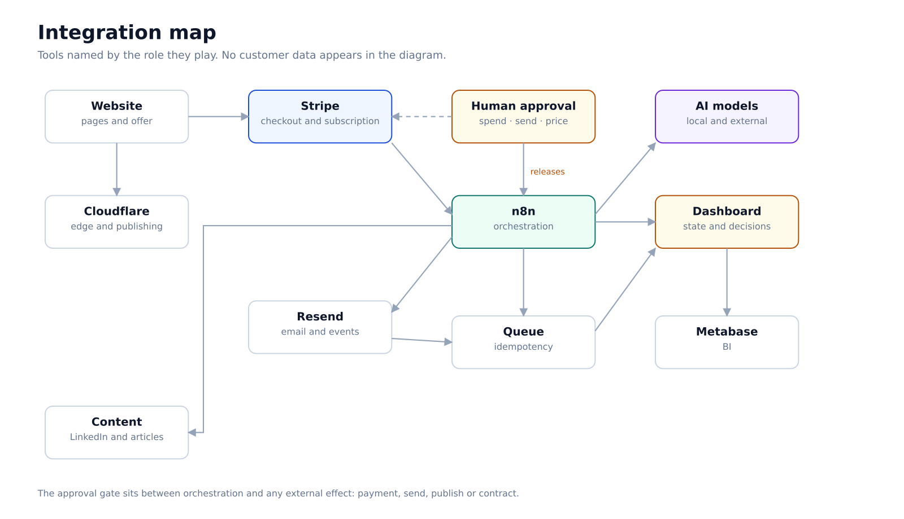
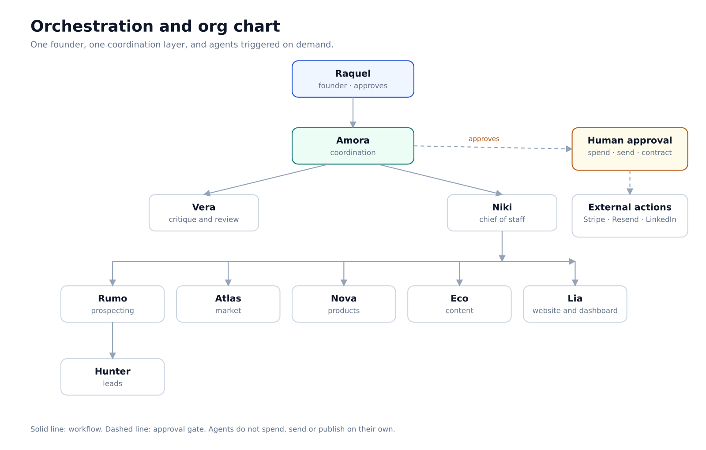
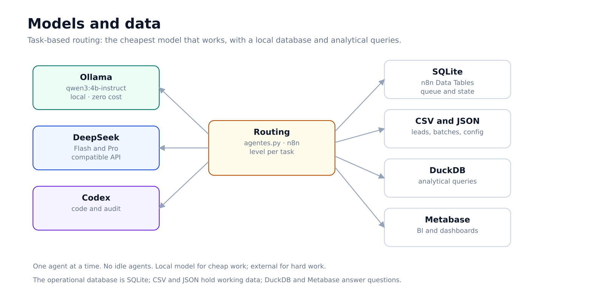
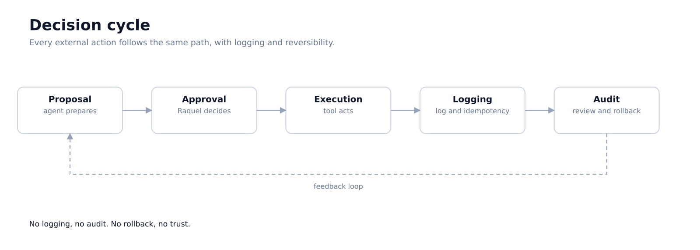

# I built the operating system of a company on my own

*2R TEK Solutions case. Written in the first person. Commercial data, clients and credentials have been omitted.*

> **Summary:** one founder, nine AI agent roles and an integrated stack to run website, payments, email, prospecting, content, dashboard and governance. The case shows the architecture, each part's role and the decisions that made the system work — including the decision to pause it.

---

## 1. The problem

I wanted to sell technical services and digital products without a team, capital or a full-time schedule. The company was one person: me. Every hour spent on repetitive work was an hour not spent on sales, product or study.

The obvious answer was automation. The hard part was deciding **what** to automate, **how** to prove it worked and **when** to stop.

This case is not about one automation. It is about building and operating the entire structure of a micro-business — website, payments, email, prospecting, content, support, dashboard, agents and governance — and what I learned by taking the system to a deliberate pause.

## 2. Project constraints

- One person operating and deciding.
- Low, predictable budget; recurring cost had to pay for itself.
- No external action without human approval: spending, sending, pricing, contracts.
- Third-party data handled under LGPD, Brazil's data protection law; prospecting under CAN-SPAM.
- Everything had to be reversible: if the cost was not justified, I would shut it down without losing data.

Those constraints shaped the architecture more than any tool.

## 3. What I built

I organised the operation into four layers.

**Presence.** A website in six languages, offer pages, local SEO pages, legal texts and script-based publishing. The goal was a coherent storefront in Portuguese and English without depending on a website builder.

**Transaction.** Checkout and subscription with Stripe, a confirmation webhook, duplicate-event handling and a processing queue. Payment is where errors cost money and trust, so this was the most tested layer and the one that needed the most defence.

**Acquisition and communication.** Transactional and prospecting email on separate subdomains, cadences, unsubscribe, event logging, validated lead lists and a simple first-contact funnel. The rule was never to mix transactional email reputation with prospecting.

**Operations.** A local dashboard with system health, commercial funnel, decisions, agents, prospecting, products, metrics and calendar. Behind it, systemd routines, Python scripts, n8n flows and a team of AI agents triggered on demand.

*Figure 1 — The four layers and the contract between them. The operations layer observes and controls the three above.*

## 4. How the pieces connect

The system is not a collection of tools; it is a flow with control points.

The website publishes through Cloudflare's edge. Checkout opens in Stripe and returns a webhook. n8n receives the event, logs it, deduplicates it and places it in the queue. The queue feeds the dashboard. Resend handles transactional email and prospecting events. The dashboard reads everything and shows the state. Metabase answers analytical questions. AI models step in where judgement is needed: classify, summarise, draft, compare.

Between orchestration and any external effect there is a barrier: **human approval**. Nothing is charged, sent, published or signed without me.

*Figure 2 — Integrations by role. The approval gate sits between n8n and any action with an external effect.*

## 5. Who did what

One narrative I do not want to repeat is "AI built everything". It did not. The system is mine; the agents execute tasks within limits I defined.

| Role | What it did | What it could not do |
|---|---|---|
| **Me, founder** | Architecture, stack choice, specification, integration, testing, operations, approval and pause | — |
| **AI agents** | Task orchestration, prospecting, market research, content, design, auditing and follow-up | Spend, send to third parties, change prices, sign contracts or publish without approval |
| **Tools** | n8n for orchestration, Stripe for payments, Resend for email, Cloudflare for the edge, Metabase for BI, Ollama and an external API for models, Trello and GitHub for management and versioning | Replace human judgement |
| **Human approval** | Mandatory gate before any external action | — |

The hard part was not plugging tools together. It was **deciding what to automate, what to keep manual and how to prove the system was alive**.

*Figure 3 — The founder approves; coordination distributes; agents execute on demand. The dashed line is the approval gate.*

## 6. The nine agents

Each agent has a role and an operating model. None is free to act outside its scope; all report to coordination and stop at the approval gate.

| Agent | Role | Routing |
|---|---|---|
| **Amora** | Coordination, priorities and distribution | Local Ollama; DeepSeek on long tasks |
| **Vera** | Critique, hidden assumptions and review | DeepSeek |
| **Niki** | Chief of staff, tasks and auditing | Codex |
| **Rumo** | Prospecting and cadences | DeepSeek |
| **Hunter** | Lead sourcing and qualification | Codex |
| **Atlas** | Market intelligence | Codex |
| **Nova** | Products and validation | DeepSeek |
| **Eco** | Content and marketing | DeepSeek |
| **Lia** | Website and dashboard | DeepSeek |

Routing changed over the project to contain cost. Claude Sonnet and Haiku were used for part of the period and later replaced by Ollama and DeepSeek. The rule that remained: **one agent at a time, no idle agents, the cheapest model that works**.

## 7. Models, database and structure

**Models.** Ollama runs `qwen3:4b-instruct` locally for classification, signals and drafts, at zero cost per call. DeepSeek (Flash and Pro) comes in through an OpenAI-compatible API and an Anthropic-compatible endpoint for text, posts and agent tasks. Codex covers code and auditing. Routing is by task, not by preference.

**Database.** SQLite is the operational database: n8n Data Tables for unsubscribe and suppression, queue and state, and a local dataset of public procurement notices. CSV and JSON hold day-to-day work — leads, batches, configuration and logs. DuckDB answers analytical queries over CSV and URLs. Metabase reads the data and builds BI dashboards.

**Structure.** systemd for timers and paths, Python for routines, n8n for orchestration, a local Node dashboard as the control plane, shell for operations scripts and a sandbox for agent execution. Credentials stay outside the project with restricted permissions; if the key or the sandbox is missing, execution fails closed.

*Figure 4 — Task-based routing between models and access to the data layers.*

## 8. Four architecture decisions

**1. Deterministic automation before AI.**
Everything repetitive and predictable became a script or a fixed flow. AI entered only where judgement was needed: classify, summarise, draft, compare. That reduced cost, increased predictability and made testing easier. A deterministic flow fails reproducibly; an agent fails creatively.

**2. On-demand agents, with a model level per task.**
No agent ran all the time. Each task had a level: local model for classification, light model for text, strong model only for complex work. The question was not "which is the best model", it was "which is the cheapest model that works".

**3. Human approval as a barrier, not a step.**
Spending, sending, pricing, contracts and publishing went through explicit approval. That made the operation slower and more reliable. I learned that autonomy without a barrier is not efficiency; it is exposure.

**4. Pausing is part of the design.**
Services, timers, containers and credentials were organised so I could stop everything in a controlled way. When the project entered a deliberate pause, I shut the operation down in one day, without losing data and without leaving loose ends. Reversibility is not a plan B; it is an architecture requirement.

## 9. The decision cycle

Every external action follows the same path: the agent prepares a proposal, I approve it, the tool executes, the system logs it and the audit reviews it. If something goes wrong, the log allows a rollback.

That cycle is what turns automation into a reliable operation. No logging, no audit. No rollback, no trust.

*Figure 5 — Proposal, approval, execution, logging and audit. The feedback loop feeds the next decision.*

## 10. What worked

- **End-to-end integration.** Website, payments, email, queue, dashboard and agents talked to each other, with logs.
- **Observability.** The dashboard showed health, funnel, decisions and metrics. I did not have to guess the state of the system.
- **Governance.** Human approval, separate email subdomains, data handling and security documentation.
- **Documentation.** Architecture, flows, decisions, known risks and reversibility were written down. That saved time and prevented repeated mistakes.
- **Controlled cost.** Local model for cheap work, external model for hard work, nothing idle.

## 11. What did not work

- **Scope before validation.** The system grew faster than the conversation with the market. The ideal order is to validate willingness to pay and only then increase scope.
- **Premature complexity.** Nine agent roles for a one-person company is beautiful architecture and heavy operations. Part of it should have stayed manual until the first sale.
- **Metrics without consequence.** Measuring everything does not replace the metric that matters at the start: would anyone use this again?
- **Solo maintenance.** An integrated system needs continuous care. With one person, every new layer increases the cost of maintaining the previous ones.
- **Local testing is not production.** Several flows were "tested locally" and not validated with real money. The difference between the two is bigger than it looks.

## 12. What I would do differently

1. **Validate willingness to pay before increasing scope.** One offer, one channel, manual conversations with ten people.
2. **Concierge MVP.** Deliver the service by hand, with a spreadsheet, until it proves it works before automating.
3. **One layer at a time.** Presence and transaction first; automation only after the first sale.
4. **Instrument from day one.** Funnel and source for every contact, without rework.
5. **Smaller stack.** Fewer pieces, less cost, less maintenance.
6. **Write the stop criterion before starting.** Date, cost and traction signal that would justify continuing.

## 13. What this case demonstrates

- Designing a complete system under real constraints.
- Integrating heterogeneous services.
- Automating with human judgement at the right point.
- Governance, security and compliance.
- Operations, observability and the ability to pause under control.
- Technical writing: architecture, decisions, risks and post-mortem.

It does not demonstrate that I am an expert in every piece. It demonstrates that I can **build, operate and close** a system with judgement.

## 14. What I learned building it

- Deciding what to automate comes before choosing the tool.
- Deterministic flow first; AI only where judgement is needed.
- Human approval works as a barrier, not as a step.
- The cheapest model that solves it, chosen per task.
- Reversibility is designed in: shut down without losing data.
- Logging decisions and risks is what makes audit and rollback possible.
- Validate willingness to pay before expanding scope.

## 15. About the author

Raquel Duarte is a student of Food Engineering (Faculdade Católica Paulista) and Multiplatform Software Development (FATEC). She works with research and development, quality and data analysis. This case describes a system she designed, integrated, operated and paused.

LinkedIn: https://www.linkedin.com/in/raquelduarte2rtek · Medium: medium.com/@raquelduarte19

## 16. Confidentiality note

This text does not include revenue, number of clients, lead volume, monthly costs, client names, credentials, tokens or internal paths. Third-party personal data has been omitted. Tools are named because they are part of the technical decision, not because there is any commercial relationship with them.
