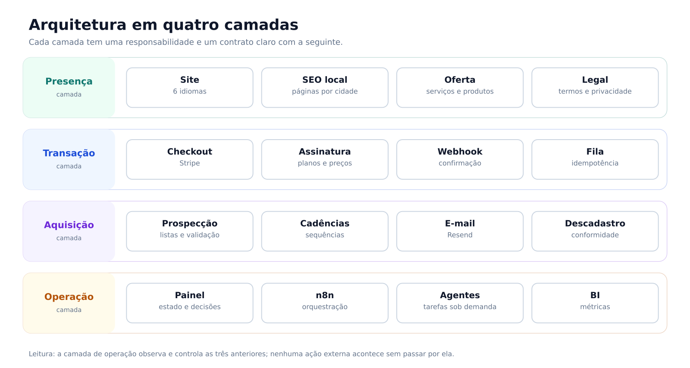
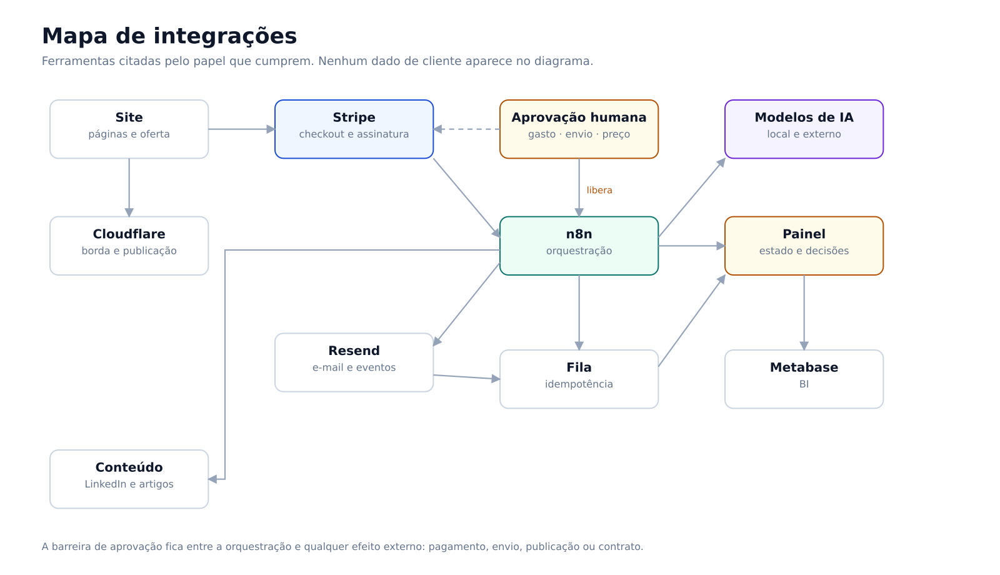
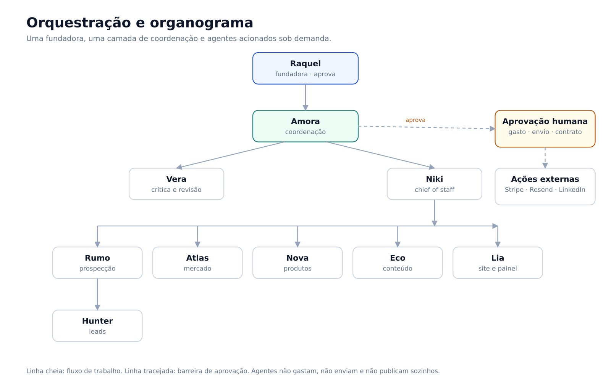
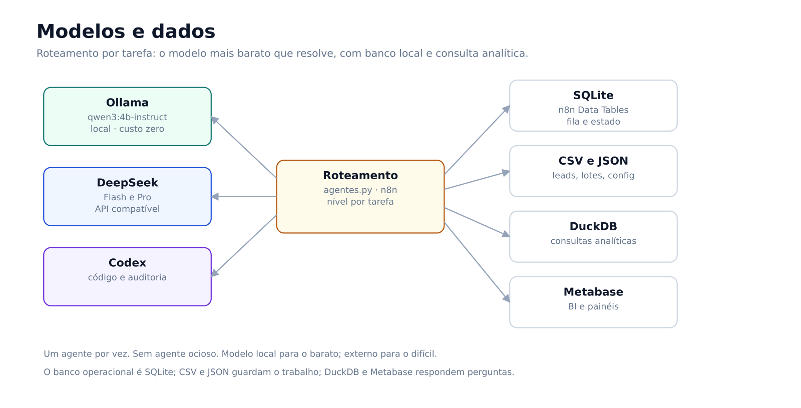
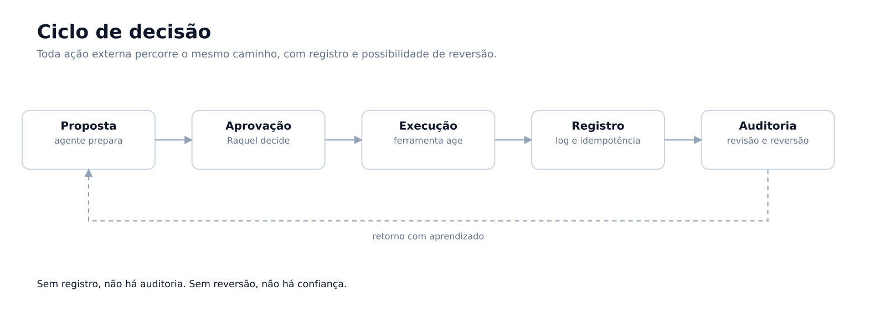

# Construí sozinha o sistema operacional de uma empresa

*Case da 2R TEK Solutions. Escrito em primeira pessoa. Dados comerciais, clientes e credenciais foram omitidos.*

> **Resumo:** uma fundadora, nove papéis de agentes de IA e uma stack integrada para cuidar de site, pagamento, e-mail, prospecção, conteúdo, painel e governança. O case mostra a arquitetura, os papéis de cada parte e as decisões que fizeram o sistema funcionar — inclusive a decisão de pausá-lo.

---

## 1. O problema

Eu queria vender serviços técnicos e produtos digitais sem equipe, sem capital e sem tempo integral. A empresa era uma pessoa: eu. Cada hora gasta em tarefa repetitiva era uma hora que não ia para venda, produto ou estudo.

A saída óbvia era automatizar. A saída difícil era decidir **o que** automatizar, **como** provar que funcionava e **quando** parar.

Este case não é sobre uma automação. É sobre construir e operar a estrutura inteira de uma microempresa — site, pagamento, e-mail, prospecção, conteúdo, atendimento, painel, agentes e governança — e sobre o que aprendi ao levar o sistema até o ponto de pausa consciente.

## 2. Restrições de projeto

- Uma pessoa operando e decidindo.
- Orçamento baixo e previsível; custo recorrente precisava se pagar.
- Nenhuma ação externa sem aprovação humana: gasto, envio, preço, contrato.
- Dados de terceiros tratados conforme LGPD; prospecção conforme CAN-SPAM.
- Tudo precisava ser reversível: se o custo não se justificasse, eu desligaria sem perder dado.

Essas restrições definiram a arquitetura mais do que qualquer ferramenta.

## 3. O que eu construí

Organizei a operação em quatro camadas.

**Presença.** Site institucional em seis idiomas, páginas de oferta, páginas locais de SEO, textos legais e publicação por script. O objetivo era ter uma vitrine coerente em português e em inglês, sem depender de construtor de site.

**Transação.** Checkout e assinatura com Stripe, webhook de confirmação, tratamento de evento duplicado e fila de processamento. Pagamento é o ponto onde erro custa dinheiro e confiança; por isso essa camada foi a mais testada e a que exigiu mais defesa.

**Aquisição e comunicação.** E-mail transacional e de prospecção em subdomínios separados, cadências, descadastro, registro de eventos, listas de leads com validação e um funil simples de primeiro contato. A regra era não misturar reputação de e-mail transacional com prospecção.

**Operação.** Um painel local com saúde do sistema, funil comercial, decisões, agentes, prospecção, produtos, métricas e calendário. Atrás dele, rotinas em systemd, scripts em Python, fluxos em n8n e uma equipe de agentes de IA acionados sob demanda.

*Figura 1 — As quatro camadas e o contrato entre elas. A camada de operação observa e controla as três anteriores.*

## 4. Como as peças se conectam

O sistema não é uma coleção de ferramentas; é um fluxo com pontos de controle.

O site publica pela borda da Cloudflare. O checkout abre no Stripe e devolve um webhook. O n8n recebe o evento, registra, deduplica e coloca na fila. A fila alimenta o painel. O Resend cuida do e-mail transacional e dos eventos de prospecção. O painel lê tudo e mostra o estado. O Metabase responde perguntas analíticas. Os modelos de IA entram onde há julgamento: classificar, resumir, rascunhar, comparar.

Entre a orquestração e qualquer efeito externo existe uma barreira: **aprovação humana**. Nada é cobrado, enviado, publicado ou assinado sem passar por mim.

*Figura 2 — Integrações por papel. A barreira de aprovação fica entre o n8n e qualquer ação com efeito externo.*

## 5. Quem fez o quê

Uma coisa que não quero repetir é a narrativa de "a IA construiu tudo". Não construiu. O sistema é meu; os agentes executam tarefas dentro de limites que eu defini.

| Papel | O que fez | O que não podia fazer |
|---|---|---|
| **Eu, fundadora** | Arquitetura, escolha de stack, especificação, integração, testes, operação, aprovação e pausa | — |
| **Agentes de IA** | Orquestração de tarefas, prospecção, pesquisa de mercado, conteúdo, design, auditoria e acompanhamento | Gastar, enviar a terceiros, mudar preço, assinar contrato ou publicar sem aprovação |
| **Ferramentas** | n8n para orquestração, Stripe para pagamento, Resend para e-mail, Cloudflare para borda, Metabase para BI, Ollama e API externa para modelos, Trello e GitHub para gestão e versionamento | Substituir decisão humana |
| **Aprovação humana** | Barreira obrigatória antes de qualquer ação externa | — |

A parte difícil não foi plugar ferramenta. Foi **decidir o que automatizar, o que deixar manual e como provar que o sistema estava vivo**.

*Figura 3 — A fundadora aprova; a coordenação distribui; os agentes executam sob demanda. A linha tracejada é a barreira de aprovação.*

## 6. Os nove agentes

Cada agente tem um papel e um modelo de operação. Nenhum é autônomo para agir fora do escopo; todos respondem à coordenação e param na barreira de aprovação.

| Agente | Papel | Roteamento |
|---|---|---|
| **Amora** | Coordenação, prioridades e distribuição | Ollama local; DeepSeek em tarefas longas |
| **Vera** | Crítica, premissas ocultas e revisão | DeepSeek |
| **Niki** | Chief of staff, tarefas e auditoria | Codex |
| **Rumo** | Prospecção e cadências | DeepSeek |
| **Hunter** | Captação e qualificação de leads | Codex |
| **Atlas** | Inteligência de mercado | Codex |
| **Nova** | Produtos e validação | DeepSeek |
| **Eco** | Conteúdo e marketing | DeepSeek |
| **Lia** | Site e painel | DeepSeek |

O roteamento mudou ao longo do projeto para conter custo. Claude Sonnet e Haiku foram usados em parte do período e depois substituídos por Ollama e DeepSeek. A regra que ficou: **um agente por vez, sem agente ocioso, modelo mais barato que resolve**.

## 7. Modelos, banco e estrutura

**Modelos.** O Ollama roda o `qwen3:4b-instruct` localmente para classificação, sinais e rascunhos, com custo zero por chamada. O DeepSeek (Flash e Pro) entra pela API compatível com OpenAI e por um endpoint compatível com Anthropic para texto, postagens e tarefas de agente. O Codex cobre código e auditoria. O roteamento é por tarefa, não por preferência.

**Banco de dados.** O SQLite é o banco operacional: Data Tables do n8n para descadastro e supressão, fila e estado, e uma base local de editais. CSV e JSON guardam o trabalho do dia a dia — leads, lotes, configuração e logs. O DuckDB responde consultas analíticas sobre CSV e URLs. O Metabase lê os dados e monta os painéis de BI.

**Estrutura.** systemd para timers e paths, Python para rotinas, n8n para orquestração, um painel Node local para o plano de controle, shell para scripts de operação e um sandbox para execução de agente. Credenciais ficam fora do projeto, com permissão restrita; se a chave ou o sandbox faltam, a execução falha fechada.

*Figura 4 — Roteamento por tarefa entre modelos e acesso às camadas de dados.*

## 8. Quatro decisões de arquitetura

**1. Automação determinística antes de IA.**
Tudo que era repetitivo e previsível virou script ou fluxo fixo. IA entrou só onde havia julgamento: classificar, resumir, rascunhar, comparar. Isso reduziu custo, aumentou previsibilidade e facilitou testar. Um fluxo determinístico falha de forma reproduzível; um agente falha de forma criativa.

**2. Agentes sob demanda, com nível de modelo por tarefa.**
Nenhum agente ficava ligado o tempo todo. Cada tarefa tinha um nível: modelo local para classificação, modelo leve para texto, modelo forte só para trabalho complexo. A pergunta não era "qual o melhor modelo", era "qual o modelo mais barato que resolve".

**3. Aprovação humana como barreira, não como etapa.**
Gasto, envio, preço, contrato e publicação passavam por aprovação explícita. Isso tornou a operação mais lenta e mais confiável. Aprendi que autonomia sem barreira não é eficiência; é exposição.

**4. Pausar faz parte do desenho.**
Serviços, timers, containers e credenciais foram organizados para que eu pudesse parar tudo de forma controlada. Quando o projeto entrou em pausa estratégica, desliguei a operação em um dia, sem perder dado e sem deixar ponta solta. Reversibilidade não é plano B; é requisito de arquitetura.

## 9. O ciclo de decisão

Toda ação externa percorre o mesmo caminho: o agente prepara uma proposta, eu aprovo, a ferramenta executa, o sistema registra e a auditoria revisa. Se algo der errado, o registro permite reverter.

Esse ciclo é o que transforma automação em operação confiável. Sem registro, não há auditoria. Sem reversão, não há confiança.

*Figura 5 — Proposta, aprovação, execução, registro e auditoria. O retorno com aprendizado alimenta a próxima decisão.*

## 10. O que funcionou

- **Integração ponta a ponta.** Site, pagamento, e-mail, fila, painel e agentes conversavam entre si, com registro.
- **Observabilidade.** O painel mostrava saúde, funil, decisões e métricas. Eu não precisava adivinhar o estado do sistema.
- **Governança.** Aprovação humana, separação de subdomínios de e-mail, tratamento de dados e documentação de segurança.
- **Documentação.** Arquitetura, fluxos, decisões, riscos conhecidos e reversibilidade ficaram escritos. Isso salvou tempo e evitou repetir erro.
- **Custo controlado.** Modelo local para o barato, modelo externo para o difícil, nada ocioso.

## 11. O que não funcionou

- **Escopo antes da validação.** O sistema cresceu mais rápido do que a conversa com o mercado. A ordem ideal é validar disposição de pagamento e só depois aumentar o escopo.
- **Complexidade prematura.** Nove papéis de agente para uma empresa de uma pessoa é arquitetura bonita e operação pesada. Parte disso deveria ter sido manual até a primeira venda.
- **Métrica sem consequência.** Medir tudo não substitui a métrica que importa no começo: alguém usaria isso de novo?
- **Manutenção solo.** Sistema integrado exige cuidado contínuo. Com uma pessoa, cada camada nova aumenta o custo de manter as anteriores.
- **Teste local não é produção.** Vários fluxos estavam "testados localmente" e não validados com dinheiro real. A diferença entre os dois é maior do que parece.

## 12. O que eu faria diferente

1. **Validar disposição de pagamento antes de aumentar o escopo.** Uma oferta, um canal, conversa manual com dez pessoas.
2. **MVP concierge.** Entregar o serviço à mão, com planilha, até provar que resolve antes de automatizar.
3. **Uma camada por vez.** Presença e transação primeiro; automação só depois da primeira venda.
4. **Instrumentar desde o dia um.** Funil e origem de cada contato, sem retrabalho.
5. **Stack menor.** Menos peças, menos custo, menos manutenção.
6. **Critério de parada escrito antes de começar.** Data, custo e sinal de tração que justificariam continuar.

## 13. O que este case demonstra

- Desenho de sistema completo sob restrição real.
- Integração de serviços heterogêneos.
- Automação com julgamento humano no ponto certo.
- Governança, segurança e conformidade.
- Operação, observabilidade e capacidade de pausar com controle.
- Escrita técnica: arquitetura, decisão, risco e post-mortem.

Não demonstra que eu sou especialista em todas as peças. Demonstra que eu consigo **montar, operar e encerrar** um sistema com critério.

## 14. O que aprendi construindo

- Decidir o que automatizar vem antes de escolher a ferramenta.
- Fluxo determinístico primeiro; IA só onde há julgamento.
- Aprovação humana funciona como barreira, não como etapa.
- O modelo mais barato que resolve, escolhido por tarefa.
- Reversibilidade se desenha junto: desligar sem perder dado.
- Registrar decisão e risco é o que permite auditar e reverter.
- Validar disposição de pagamento antes de aumentar o escopo.

## 15. Sobre a autora

Raquel Duarte é estudante de Engenharia de Alimentos (Faculdade Católica Paulista) e de Desenvolvimento de Software Multiplataforma (FATEC). Atua com pesquisa e desenvolvimento, qualidade e análise de dados. Este case descreve um sistema que ela desenhou, integrou, operou e pausou.

LinkedIn: https://www.linkedin.com/in/raquelduarte2rtek · Medium: medium.com/@raquelduarte19

## 16. Nota de confidencialidade

Este texto não inclui receita, número de clientes, volume de leads, custos mensais, nomes de clientes, credenciais, tokens ou caminhos internos. Dados pessoais de terceiros foram omitidos. Ferramentas são citadas porque fazem parte da decisão técnica, não porque exista qualquer relação comercial com elas.
